# LoL & Doomscroll Limiter

**English** | [Magyar](#lol--és-görgetéskorlátozó-magyar)

A Windows 11 application with a Chrome extension that limits League of Legends PvP matches and doomscrolling
(short videos and the Facebook feed). The user interface is bilingual (English and Hungarian): the installer and the
programs follow the Windows display language, and the language chosen in the installer applies to the programs too.

**Chrome extension:** [Install from the Chrome Web Store](https://chromewebstore.google.com/detail/lol-%C3%A9s-g%C3%B6rget%C3%A9skorl%C3%A1toz%C3%B3/mkoeoadekdfnbjpmhiabpjlmhdoimcml) (ID: `mkoeoadekdfnbjpmhiabpjlmhdoimcml`). For full protection, the [installer](https://github.com/viktorferenczi/LolAndDoomScrollFix/releases/latest) has to be installed together with the extension.

| Activity | Limit (default) | When the limit is used up |
|---|---:|---|
| LoL PvP | 3 matches | A new PvP search is cancelled, a match accept is declined |
| Instagram Reels, TikTok, YouTube Shorts, Facebook Reels | 60 minutes together (set in the installer) | The page is blocked |
| Facebook home feed | 60 minutes on its own (set in the installer) | The feed is blocked |

Chosen at install time:

- **Reset:** rolling 24 hours (default - every use is released exactly 24 hours later), or a daily reset at a chosen hour (e.g. 03:00).
- **Time limits** in minutes for short videos and the Facebook feed (default: 60 and 60 minutes).
- **Weekends:** by default there is no limit on Saturday and Sunday, and weekend use does not count toward the limit; when ticked, the limits also apply on weekends.

**Rest-day bonus:** if you play no PvP match on a day, you get +1 match the next day; if you watch 0 minutes of short videos on a day, +30 minutes the next day; likewise +30 minutes for the Facebook feed. The three bonuses are independent and do not stack: after several empty days they are given only once. The size of the bonuses is set in the installer (0 = off).

**Admin password:** an admin password (at least 6 characters) has to be set during installation. It is needed to open the admin settings and to uninstall the program, in addition to the Windows administrator approval (UAC). Only a verifier (PBKDF2-SHA256) of the password is stored, in the data folder that normal users cannot access.

**Admin settings:** the "Admin settings…" button (in the tray icon's menu and in the Details window, under "Check for updates") asks for the Windows administrator password (UAC), then for the admin password, and then opens an editor where the settings given at install time (reset, limits, weekends, rest-day bonus, banned hours) can be changed; no reinstall is needed.

**Extra allowance for a day:** in the admin editor, extra LoL matches, short-video time and Facebook-feed time can be given for a chosen day (added to the day's base limit and the rest-day bonus). The day chooser does not list past days, and weekends are greyed out and cannot be chosen when the weekend limit is off (there is no limit on weekends anyway). The extra does not override banned hours.

**Updates:** the "Check for updates" button (in the tray icon's menu and in the Details window) finds the latest release, downloads and verifies it (SHA-256), and starts the installer; the installation needs administrator approval, and the settings and counters are kept.

**Banned hours:** at install time a daily banned period can be set per limit (LoL, short videos, Facebook feed), e.g. 01:00-05:00. During it that activity cannot be used at all, even if some of the limit is left; the limit and the reset are not affected.

TFT, bot games, practice, custom games and spectating do not use up the LoL limit; a confirmed remake gives the attempt back.
On a detection or operation error the program **lets everything through and reports the error** (tray icon, the extension's red "!" badge).

## License

You may freely download and use the official, unmodified releases from the [releases page](https://github.com/viktorferenczi/LolAndDoomScrollFix/releases) at no charge. Modifying the source code, passing it on, and selling the program (or any part of it) are not allowed without written permission. See [LICENSE](LICENSE). The program is provided "as is", without warranty.

If you find it useful and want to support the software: [buymeacoffee.com/viktorferenczi](https://buymeacoffee.com/viktorferenczi) ☕

## Screenshots

<p align="center"></p>

| | |
|---|---|
| 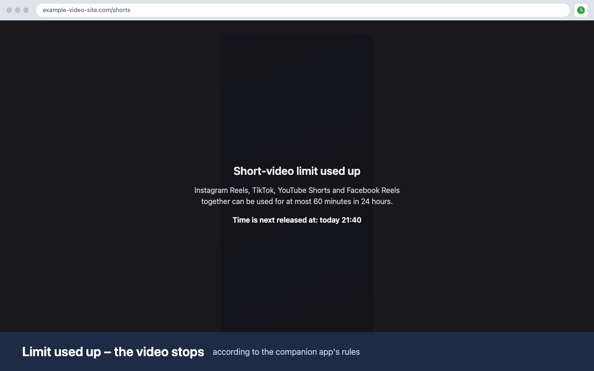<br>**Short-video limit used up** | 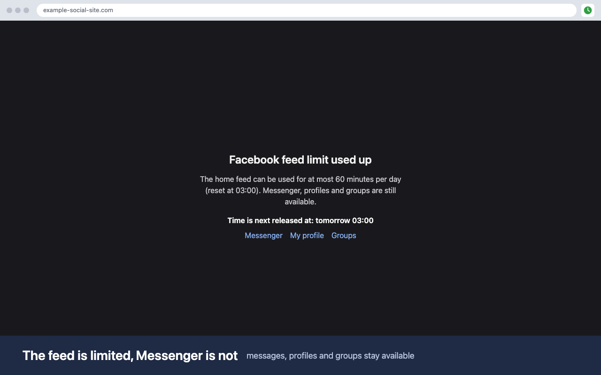<br>**Facebook feed: Messenger stays available** |
| 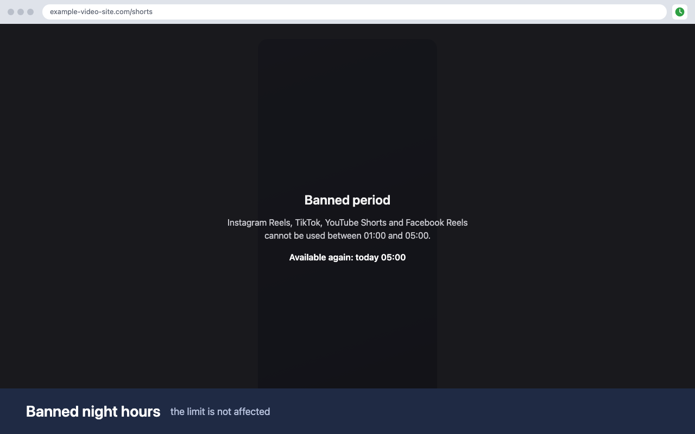<br>**Banned hours** | 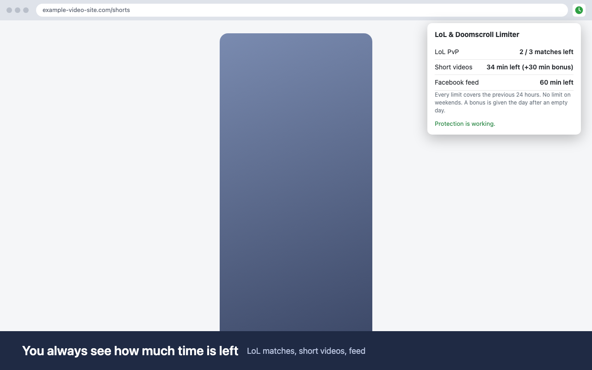<br>**You always see how much time is left** |

*The images are illustrations: they show the extension's real interface on neutral example pages.*

## What does the application do?

The goal is to curb endless scrolling and excessive League of Legends play. Three cooperating parts do the work:

- **Windows service** (`Limiter.Service`): runs in the background with system rights, so a normal user cannot stop it. It counts the usage in a protected SQLite database and decides whether a limit is used up.
- **Chrome extension**: watches how much time you spend on Instagram Reels, TikTok, YouTube Shorts and Facebook Reels, and on the Facebook home feed. It only counts the active, visible, used tab (a background tab or a locked screen does not count). When a limit is used up, it blocks the page. Click the extension's icon to see the remaining time in the popup.
- **Tray application** (`Limiter.Tray`): a bilingual (English/Hungarian) tray icon, refreshed every 5 seconds. Green = all is well, yellow = warning, red = error. The menu and the "Details" window show the remaining LoL matches, short-video time, feed time and the time the next limit is released.

### How it works in brief

1. **Reset.** By default a rolling 24-hour limit: there is no midnight reset, it always looks at the usage of the last 24 hours, so a match or a minute is released again exactly 24 hours later. A daily reset at a given hour (e.g. 03:00) can be chosen in the installer instead. By default there is no limit on weekends; this can also be changed in the installer.
2. **LoL matches.** The service watches the League client's local (LCU) API. Only PvP queues (e.g. ranked, normal) count; TFT, bot games, practice, custom games and spectating do not. When the limit is used up, it cancels a new PvP search and declines the match accept. A confirmed remake gives the used attempt back.
3. **Short videos.** Instagram Reels, TikTok, YouTube Shorts and Facebook Reels use a **shared** limit (default: 60 minutes, set in the installer).
4. **Facebook feed.** The home feed gets a **separate** limit (default: 60 minutes, set in the installer).
5. **Rest-day bonus.** If nothing was used from a limit on the previous day, that limit is larger today (LoL +1 match, short videos +30 minutes, feed +30 minutes). It does not stack. For exempt weekends, Friday counts on Monday. It is only given for a fully measured day: on a fresh install it starts after the first full day.
6. **Banned hours.** When enabled, during the given hours (e.g. 01:00-05:00) there is no new PvP match, and short videos or the feed are blocked, even if some of the limit is left. A match in progress may finish.
7. **Fault tolerance.** If detection or operation fails, the program does not lock you out: it lets everything through and reports the error (red tray icon, the extension's red "!" badge).
8. **Incognito mode.** Allowed. The extension only measures and limits in an incognito window if the "Allow in Incognito" switch is on at chrome://extensions; the user decides that.
9. **Protection against circumvention.** In a production install the Chrome policies make the extension mandatory and disable guest mode and the extensions' developer mode; changing the settings needs the administrator password (the idea: a trusted person knows it, not you).

For installation and verification see the guides linked below.

## Versions

The published releases can be downloaded from the [releases page](https://github.com/viktorferenczi/LolAndDoomScrollFix/releases) (the installer, the extension packages and the checksums). The tray application's "Check for updates" button installs the latest one. The list starts with the newest.

### Unreleased

- **Bilingual interface (English and Hungarian):** installer, tray application, admin panel, service messages and the Chrome extension (via `_locales`). The language follows the Windows display language; the installer records the chosen language for the programs.
- English documentation (`docs/INSTALL.md`, `docs/VERIFICATION.md`, English Web Store listing) and this English README first.

### 1.6.1 - 2026-10-28

- Documentation: version list in the README; the program's behaviour did not change.

### 1.6.0 - 2026-10-28

- **Extra allowance for a day:** in the admin settings, extra LoL matches, short-video time and Facebook-feed time can be given for a chosen day. The day chooser does not list past days, and weekends cannot be chosen when the weekend limit is off. With a daily reset the day starts at the reset hour. The extra also shows in the tray and in the extension's popup.
- **Admin password:** set on a new installer page (at least 6 characters); needed to open the admin settings and to uninstall, in addition to the Windows administrator approval. Only a PBKDF2-SHA256 verifier is stored in the admin-only data folder. The password can be changed in the settings window.
- Silent install and uninstall no longer hang on the password check; the installer also works when started from PowerShell 7.
- A Windows end-to-end test (install, password, admin panel, uninstall) on GitHub Actions.

### 1.5.2 - 2026-10-28

- The installer's default extension ID is the extension published in the Chrome Web Store (the development ID in development mode).

### 1.5.1 - 2026-10-27

- All-rights-reserved license: the official releases may be downloaded and used free of charge; modifying the source and selling are forbidden.
- Maintenance: version number and documentation.

### 1.5.0 - 2026-10-27

- **Admin settings:** opened from the tray icon's menu and the Details window (with Windows administrator approval). The values given at install time can be changed here: reset, limits, weekends, rest-day bonus, banned hours. The values are validated before saving, and the service picks them up within 30 seconds.
- Chrome Web Store publishing material and a privacy policy (`docs/CHROME_WEBSTORE.md`, `docs/PRIVACY.md`).

### 1.4.1 - 2026-10-26 (first published release)

What the program can do in this release:

- **Limits:** the number of LoL PvP matches, the shared time limit of short videos (Instagram Reels, TikTok, YouTube Shorts, Facebook Reels) and the separate time limit of the Facebook feed. A shared counter for all Chrome profiles and LoL accounts.
- **Chosen at install time:** rolling 24 hours or a daily reset at a given hour; the minutes of the limits; a weekend limit (off by default).
- **Rest-day bonus:** after an empty day more allowance is given the next day (it does not stack); its size is set in the installer.
- **Banned hours:** a daily period per limit during which nothing can be used; the limit is not affected.
- **Incognito:** decided by the "Allow in Incognito" switch.
- **Game safety:** the program only watches the LoL client, does not touch anything during a game, and its load is low.
- **Check for updates button:** downloads and installs with a checksum and strict verification of the GitHub releases.
- **Fault tolerance:** on a detection or operation error the program lets everything through and reports the error (tray icon, the extension's red badge).
- Release automation: pushing a `vX.Y.Z` tag makes GitHub Actions build and publish the installer.

## Structure

```
src/
  Limiter.Common/      Tiny shared library: bilingual texts (Loc)
  Limiter.Core/        Rolling 24-hour limits, SQLite store, LoL queue classification, match counter (platform independent, tested)
  Limiter.Protocol/    Messages and client of the named-pipe protocol (verifying the service's authenticity)
  Limiter.Service/     Windows service: counters, watching the LoL client (LCU), pipe server
  Limiter.NativeHost/  Chrome Native Messaging host: forwards the extension's messages to the service
  Limiter.Updates/     Checking for updates and downloading the installer with a checksum (platform independent, tested)
  Limiter.Tray/        Bilingual (English/Hungarian) tray application
extension/             Chrome extension (Manifest V3, English and Hungarian in _locales) + Node tests
installer/             build.ps1, install.ps1, uninstall.ps1, Inno Setup script (English and Hungarian)
tests/                 xUnit tests
tools/                 Windows end-to-end test (UI Automation)
docs/                  INSTALL.md (installation), VERIFICATION.md (checks), CHROME_WEBSTORE.md, PRIVACY.md
                       (Hungarian: TELEPITES.md, ELLENORZES.md)
```

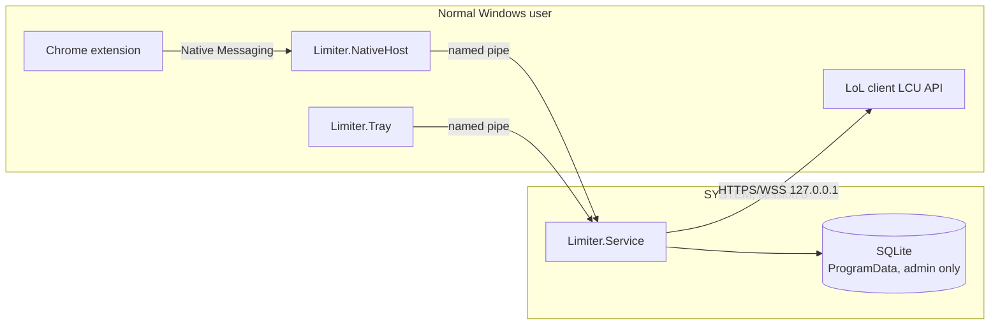

## Quick commands

```bash
dotnet test tests/Limiter.Core.Tests
```

```bash
node --test extension/test/*.test.js
```

On Windows, the whole package (tests, publish, extension packages, installer):

```powershell
powershell -ExecutionPolicy Bypass -File installer\build.ps1
```

Details: [docs/INSTALL.md](docs/INSTALL.md) and [docs/VERIFICATION.md](docs/VERIFICATION.md) (in Hungarian: [docs/TELEPITES.md](docs/TELEPITES.md), [docs/ELLENORZES.md](docs/ELLENORZES.md)).

---

# LoL- és görgetéskorlátozó (magyar)

[English version above](#lol--doomscroll-limiter)

Windows 11-es alkalmazás Chrome-bővítménnyel. A felület kétnyelvű (angol és magyar): a telepítő és a programok a Windows megjelenítési nyelvét követik, a telepítőben választott nyelv pedig a programokra is érvényes.

**Chrome-bővítmény:** [Telepítés a Chrome Web Store-ból](https://chromewebstore.google.com/detail/lol-%C3%A9s-g%C3%B6rget%C3%A9skorl%C3%A1toz%C3%B3/mkoeoadekdfnbjpmhiabpjlmhdoimcml) (azonosító: `mkoeoadekdfnbjpmhiabpjlmhdoimcml`). A teljes védelemhez a bővítmény mellé a [telepítőt](https://github.com/viktorferenczi/LolAndDoomScrollFix/releases/latest) is telepíteni kell.

| Tevékenység | Korlát (alapértelmezés) | A keret elfogyásakor |
|---|---:|---|
| LoL PvP | 3 meccs | Új PvP-keresés megszakítva, meccselfogadás elutasítva |
| Instagram Reels, TikTok, YouTube Shorts, Facebook Reels | Együtt 60 perc (telepítéskor állítható) | A felület blokkolva |
| Facebook kezdőlapi hírfolyam | Külön 60 perc (telepítéskor állítható) | A hírfolyam blokkolva |

Telepítéskor választható:

- **Visszaállítás:** gördülő 24 óra (alapértelmezés — minden felhasználás pontosan 24 órával később szabadul fel), vagy napi nullázás egy választott órában (pl. 03:00).
- **Időkeretek** percben a rövid videókra és a Facebook-hírfolyamra (alapértelmezés: 60-60 perc).
- **Hétvége:** alapértelmezésként szombaton és vasárnap nincs korlát, és a hétvégi használat nem számít bele a keretbe; bejelölve a korlátok hétvégén is érvényesek.

**Pihenőnap-jutalom:** ha egy napon egy PvP-meccset sem játszol, másnap +1 meccs jár; ha egy napon 0 percet nézel rövid videót, másnap +30 perc; ugyanígy a Facebook-hírfolyamnál +30 perc. A három jutalom független egymástól, és nem halmozódik: több üres nap után is csak egyszer jár. A jutalmak mértéke telepítéskor állítható (0 = kikapcsolva).

**Admin jelszó:** a telepítéskor meg kell adni egy admin jelszót (legalább 6 karakter). Ez kell az admin beállítások megnyitásához és a program eltávolításához, a Windows rendszergazdai jóváhagyása (UAC) mellett. A jelszóból csak egy ellenőrző (PBKDF2-SHA256) tárolódik az adatmappában, amelyhez normál felhasználó nem fér hozzá.

**Admin beállítások:** a tálcaikon menüjében és a Részletek ablakban („Frissítések keresése” alatt) az „Admin beállítások…” gomb a Windows rendszergazdai jelszavát (UAC), majd az admin jelszót kéri, és utána megnyit egy szerkesztőt, ahol a telepítéskor megadott beállítások (visszaállítás, keretek, hétvége, pihenőnap-jutalom, tiltott órák) módosíthatók; újratelepítés nem kell.

**Extra keret egy napra:** az admin szerkesztőben egy kiválasztott napra extra LoL-meccs, rövid videós és Facebook-hírfolyam-idő adható (a nap alapkeretéhez és a pihenőnap-jutalomhoz adódik). A napválasztóban a múltbeli napok nem szerepelnek, a hétvégék pedig szürkék és nem választhatók, ha a hétvégi korlát ki van kapcsolva (hétvégén úgysincs korlát). A tiltott órákat az extra nem írja felül.

**Frissítés:** a tálcaikon menüjében és a Részletek ablakban a „Frissítések keresése” gomb megkeresi a legújabb kiadást, letölti és ellenőrzi (SHA-256), majd elindítja a telepítőt; a telepítéshez rendszergazdai jóváhagyás kell, a beállítások és a számlálók megmaradnak.

**Tiltott órák:** telepítéskor keretenként (LoL, rövid videók, Facebook-hírfolyam) megadható egy napi tiltott időszak, pl. 01:00–05:00. Ilyenkor az adott dolog egyáltalán nem használható, akkor sem, ha a keretből maradt; a keretet és a nullázást nem érinti.

TFT, botmeccs, gyakorlás, egyéni játék és néző mód nem fogyasztja a LoL-keretet; az igazolt remake visszaadja az alkalmat.
Felismerési vagy működési hibánál a program **enged tovább, és hibát jelez** (tálcaikon, a bővítmény piros „!” jelvénye).

## Licenc

A [kiadások oldaláról](https://github.com/viktorferenczi/LolAndDoomScrollFix/releases) szabadon letöltheted és ingyen használhatod a hivatalos, módosítatlan kiadásokat. A forráskód módosítása, továbbadása és a program (vagy bármely része) értékesítése írásos engedély nélkül nem megengedett. Részletek: [LICENSE](LICENSE). A program garancia nélkül, „ahogy van” formában készült.

Ha hasznosnak találod és támogatni szeretnéd a szoftvert: [buymeacoffee.com/viktorferenczi](https://buymeacoffee.com/viktorferenczi) ☕

## Képek

<p align="center">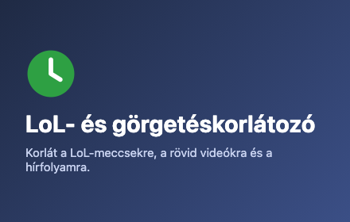</p>

| | |
|---|---|
| 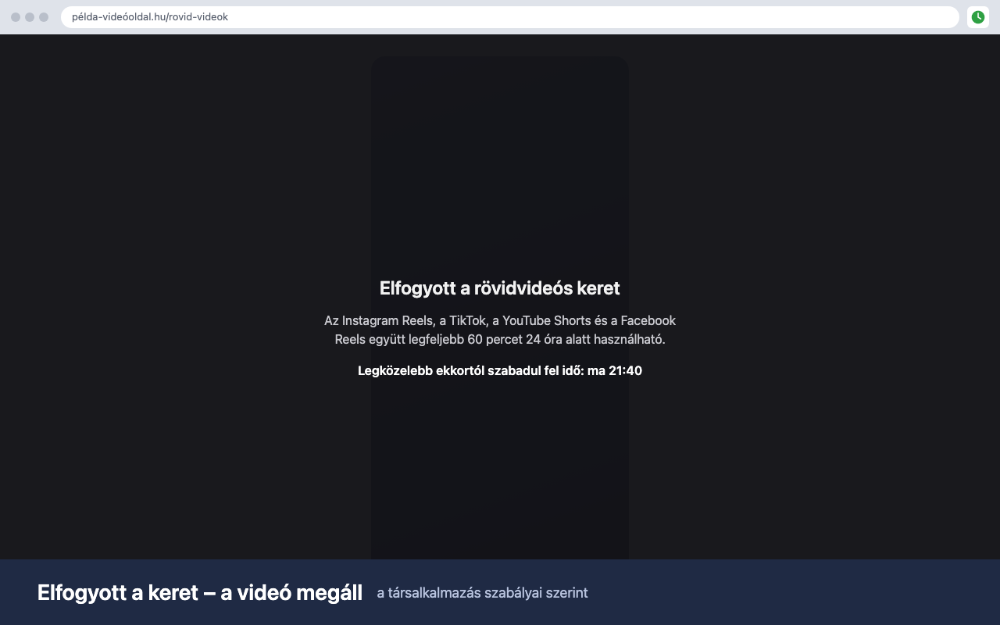<br>**Elfogyott a rövidvideós keret** | 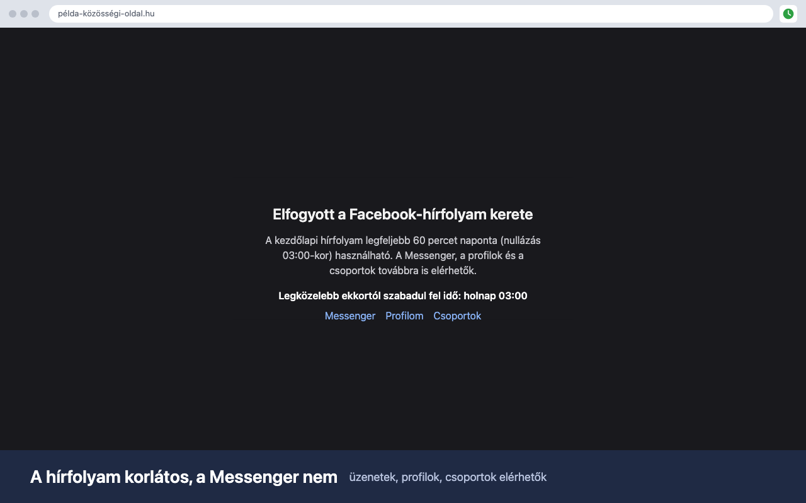<br>**Facebook-hírfolyam: a Messenger továbbra is elérhető** |
| 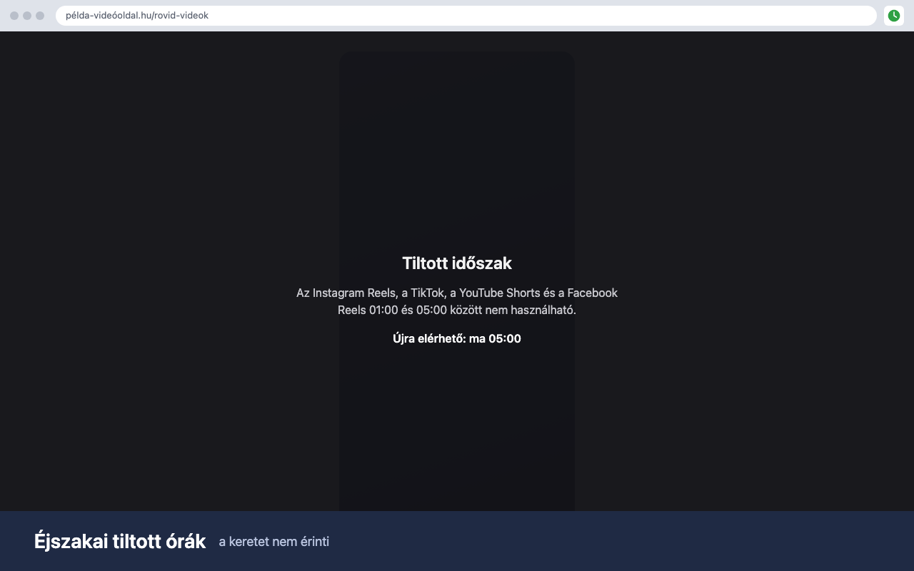<br>**Tiltott órák** | 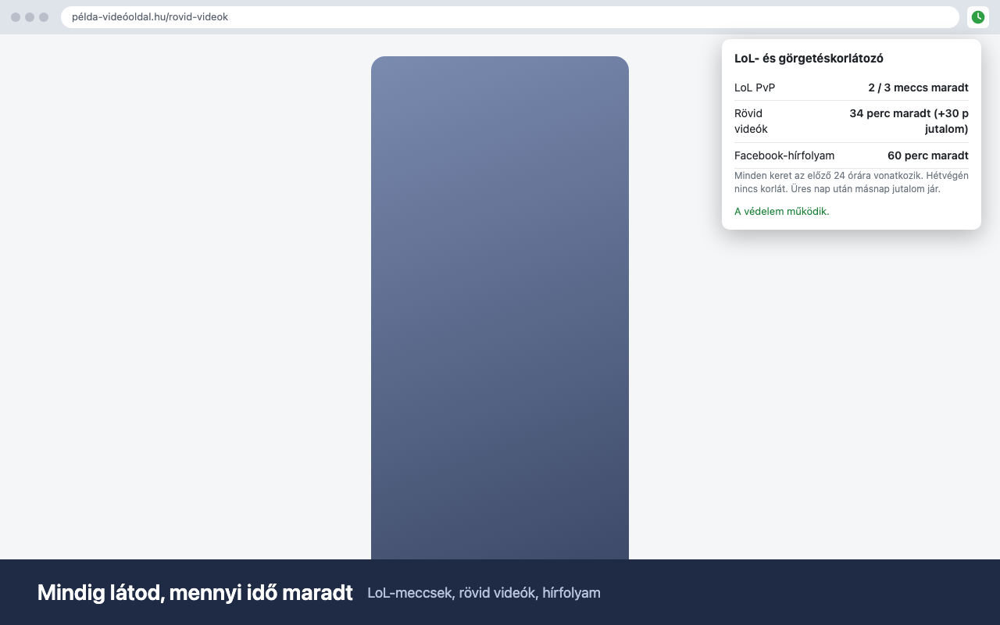<br>**Mindig látod, mennyi idő maradt** |

*A képek szemléltető ábrák: a bővítmény valódi felületét mutatják, semleges példaoldalakon.*

## Mit tud az alkalmazás?

A cél az, hogy megfékezze a végtelen görgetést és a túlzott League of Legends-játékot. Három, egymással együttműködő rész dolgozik:

- **Windows-szolgáltatás** (`Limiter.Service`): a háttérben, rendszerjogosultsággal fut, ezért normál felhasználó nem tudja leállítani. Számolja a felhasználást egy védett SQLite-adatbázisban, és ő dönti el, hogy a keret elfogyott-e.
- **Chrome-bővítmény**: figyeli, mennyi időt töltesz Instagram Reelsen, TikTokon, YouTube Shortson és Facebook Reelsen, valamint a Facebook kezdőlapi hírfolyamán. Csak az aktív, látható, használt lapot számolja (háttérlap vagy zárolt képernyő nem számít). Elfogyott kereten blokkolja a felületet. A bővítmény ikonjára kattintva a popupban látod a hátralévő időt.
- **Tálcaalkalmazás** (`Limiter.Tray`): kétnyelvű (angol/magyar) tálcaikon, 5 másodpercenként frissül. Zöld = minden rendben, sárga = figyelmeztetés, piros = hiba. A menüben és a „Részletek” ablakban látszik a hátralévő LoL-meccs, a rövidvideó-idő, a hírfolyamidő és a következő felszabaduló keret időpontja.

### Működés röviden

1. **Visszaállítás.** Alapértelmezésként gördülő 24 órás keret: nincs éjféli nullázás, mindig az elmúlt 24 óra felhasználását nézi, így egy meccs vagy egy perc pontosan 24 óra múlva szabadul fel újra. Telepítéskor választható helyette napi nullázás egy adott órában (pl. 03:00). Alapértelmezésként hétvégén nincs korlát; ez is a telepítőben kapcsolható.
2. **LoL-meccsek.** A szolgáltatás a League kliens helyi (LCU) API-ját figyeli. Csak a PvP-sorok (pl. rangsorolt, normál) számítanak; TFT, botmeccs, gyakorlás, egyéni játék és néző mód nem. Ha a keret elfogyott, az új PvP-keresést megszakítja, a meccselfogadást elutasítja. Az igazolt remake (újrakezdett meccs) visszaadja az elhasznált alkalmat.
3. **Rövidvideók.** Instagram Reels, TikTok, YouTube Shorts és Facebook Reels **közös** keretet használ (alapértelmezés: 60 perc, telepítéskor állítható).
4. **Facebook-hírfolyam.** A kezdőlapi hírfolyam **külön** keretet kap (alapértelmezés: 60 perc, telepítéskor állítható).
5. **Pihenőnap-jutalom.** Ha az előző napon egy keretből semmi sem fogyott, aznap ahhoz több jár (LoL +1 meccs, rövid videó +30 perc, hírfolyam +30 perc). Nem halmozódik. Mentes hétvégénél hétfőn a péntek számít. Csak teljesen mért napért jár: friss telepítéskor az első teljes nap után kezdődik.
6. **Tiltott órák.** Bekapcsolva a megadott órák között (pl. 01:00–05:00) nincs új PvP-meccs, illetve a rövid videó vagy a hírfolyam blokkolva van, akkor is, ha a keretből maradt. A folyamatban lévő meccs befejezhető.
7. **Hibatűrés.** Ha a felismerés vagy a működés hibázik, a program nem zár ki, hanem tovább enged, és hibát jelez (piros tálcaikon, a bővítmény piros „!” jelvénye).
8. **Inkognitó mód.** Engedélyezett. A bővítmény inkognitó ablakban csak akkor mér és korlátoz, ha a chrome://extensions oldalon be van kapcsolva az „Engedélyezés inkognitó módban” kapcsoló; ezt a felhasználó maga dönti el.
9. **Kijátszás elleni védelem.** Éles telepítésben a Chrome-szabályok kötelezővé teszik a bővítményt, tiltják a vendégmódot és a bővítmények fejlesztői módját; a beállítások módosításához rendszergazdai jelszó kell (a gondolat: ezt egy megbízható személy ismeri, nem te).

A telepítésről és az ellenőrzésről lásd lent a hivatkozott útmutatókat.

## Verziók

_Még ki nem adott változtatások:_ kétnyelvű (angol és magyar) felület (telepítő, tálcaalkalmazás, admin felület, szolgáltatásüzenetek, Chrome-bővítmény), angol dokumentáció, és az angol README az első.

A közzétett kiadások a [kiadások oldalán](https://github.com/viktorferenczi/LolAndDoomScrollFix/releases) tölthetők le (a telepítő, a bővítménycsomagok és az ellenőrzőösszegek). A tálcaalkalmazás „Frissítések keresése” gombja a legújabbat telepíti. A lista a legújabbal kezdődik.

### 1.6.1 — 2026-10-28

- Dokumentáció: verziólista a README-ben; a program működése nem változott.

### 1.6.0 — 2026-10-28

- **Extra keret egy napra:** az admin beállításokban egy kiválasztott napra extra LoL-meccs, rövid videós és Facebook-hírfolyam-idő adható. A napválasztóban a múltbeli napok nem szerepelnek, a hétvégék pedig nem választhatók, ha a hétvégi korlát ki van kapcsolva. Napi nullázásnál a nap a nullázás órájától tart. Az extra látszik a tálcán és a bővítmény felugró ablakában is.
- **Admin jelszó:** a telepítés új lapján adható meg (legalább 6 karakter); az admin beállítások megnyitásához és a program eltávolításához kell, a Windows rendszergazdai jóváhagyása mellett. Csak egy PBKDF2-SHA256 ellenőrző tárolódik az admin-only adatmappában. A beállítások ablakban a jelszó módosítható.
- Csendes telepítés és eltávolítás nem akad el a jelszó-ellenőrzésen; a telepítő PowerShell 7-ből indítva sem hibázik.
- Windowsos végpontok közötti próba (telepítés, jelszó, admin felület, eltávolítás) a GitHub Actionsben.

### 1.5.2 — 2026-10-28

- A telepítő alapértelmezett bővítményazonosítója a Chrome Web Store-ban közzétett bővítmény (fejlesztői módban a fejlesztői azonosító).

### 1.5.1 — 2026-10-27

- Szerzői jogi (all rights reserved) licenc: a hivatalos kiadások letölthetők és ingyen használhatók, a forráskód módosítása és az értékesítés tilos.
- Karbantartás: verziószám és dokumentáció.

### 1.5.0 — 2026-10-27

- **Admin beállítások:** a tálcaikon menüjéből és a Részletek ablakból nyílik (Windows rendszergazdai jóváhagyással). Itt módosíthatók a telepítéskor megadott értékek: visszaállítás, keretek, hétvége, pihenőnap-jutalom, tiltott órák. Mentés előtt ellenőrzi az értékeket, a szolgáltatás 30 másodpercen belül átveszi őket.
- Chrome Web Store-közzétételi anyagok és adatvédelmi nyilatkozat (`docs/CHROME_WEBSTORE.md`, `docs/PRIVACY.md`).

### 1.4.1 — 2026-10-26 (első közzétett kiadás)

A program a következőket tudja ebben a kiadásban:

- **Korlátok:** LoL PvP-meccsek száma, rövid videók (Instagram Reels, TikTok, YouTube Shorts, Facebook Reels) közös időkerete és a Facebook-hírfolyam külön időkerete. Közös számláló minden Chrome-profilra és LoL-fiókra.
- **Telepítéskor választható:** gördülő 24 óra vagy napi nullázás egy megadott órában; a keretek percei; hétvégi korlát (alapból nincs).
- **Pihenőnap-jutalom:** üres nap után másnap több keret jár (nem halmozódik); a mértéke a telepítőben állítható.
- **Tiltott órák:** keretenként megadható napi időszak, amikor semmi sem használható; a keretet nem érinti.
- **Inkognitó:** az „Engedélyezés inkognitó módban” kapcsoló dönt róla.
- **Játékbiztonság:** a program csak a LoL-klienst figyeli, játék közben nem nyúl semmihez, és a terhelése alacsony.
- **Frissítések keresése gomb:** ellenőrzőösszeggel és a GitHub-kiadások szigorú ellenőrzésével tölt le és telepít.
- **Hibatűrés:** felismerési vagy működési hibánál a program enged tovább, és hibát jelez (tálcaikon, a bővítmény piros jelvénye).
- Kiadás-automatizálás: a `vX.Y.Z` címke feltöltésekor a GitHub Actions lefordítja és közzéteszi a telepítőt.

## Felépítés

```
src/
  Limiter.Common/      Közös, apró segédkönyvtár: kétnyelvű szövegek (Loc)
  Limiter.Core/        Gördülő 24 órás keretek, SQLite-tár, LoL-sorbesorolás, meccsszámláló (platformfüggetlen, tesztelt)
  Limiter.Protocol/    A named pipe protokoll üzenetei és kliense (a szolgáltatás hitelességének ellenőrzésével)
  Limiter.Service/     Windows-szolgáltatás: számlálók, LoL-kliens (LCU) figyelése, pipe-szerver
  Limiter.NativeHost/  Chrome Native Messaging host: továbbítja a bővítmény üzeneteit a szolgáltatásnak
  Limiter.Updates/     Frissítések keresése és a telepítő letöltése ellenőrzőösszeggel (platformfüggetlen, tesztelt)
  Limiter.Tray/        Kétnyelvű (angol/magyar) tálcaalkalmazás
extension/             Chrome-bővítmény (Manifest V3) + Node-tesztek
installer/             build.ps1, install.ps1, uninstall.ps1, Inno Setup-szkript
tests/                 xUnit-tesztek
docs/                  INSTALL.md / TELEPITES.md (telepítés), VERIFICATION.md / ELLENORZES.md (próbák), CHROME_WEBSTORE.md, PRIVACY.md
```

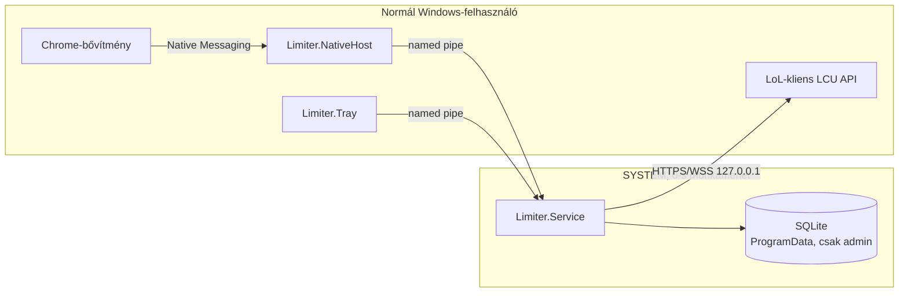

## Gyors parancsok

```bash
dotnet test tests/Limiter.Core.Tests
```

```bash
node --test extension/test/*.test.js
```

Windows alatt a teljes csomag (tesztek, közzététel, bővítménycsomagok, telepítő):

```powershell
powershell -ExecutionPolicy Bypass -File installer\build.ps1
```

Részletek: [docs/TELEPITES.md](docs/TELEPITES.md) és [docs/ELLENORZES.md](docs/ELLENORZES.md) (angolul: [docs/INSTALL.md](docs/INSTALL.md), [docs/VERIFICATION.md](docs/VERIFICATION.md)).
